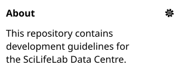

# GitHub

- [Authentication](#authentication)
- [Repositories](#repositories)
- [Members, roles & teams](#members-roles--teams)

## Authentication

All members of the ScilifelabDataCentre GitHub Organisation or contributors to repositories maintained by the organisation must have the following configured:

1. Two Factor Authentication (2FA). This is enforced by the organisation settings. Two configure 2FA, [follow GitHub's instructions](https://docs.github.com/en/authentication/securing-your-account-with-two-factor-authentication-2fa/configuring-two-factor-authentication).
   - Make sure that you keep the backup codes and/or set up multiple ways to login in case you e.g. lose your phone
2. Commit signing. Follow [these instructions](./commit_signing.md).

## Repositories

All repositories for DC services and components:

- Belong in our [organisation](https://github.com/ScilifelabDataCentre). If you are unsure, or if the repository is a collaborative work, contact the [SciLifeLab Architecture Board](https://github.com/orgs/SciLifeLab/teams/architecture-board).
- Should be public, unless there's a specific reason why it should be private (e.g. deployment repositories).
- Should have a brief description in the _About_ section, even if it's a Proof of Concept (PoC) or test that you're working on alone. See the example below.

> [!NOTE]
> **Use the repository temmplate [data-centre-template](https://github.com/ScilifelabDataCentre/data-centre-template) when creating a new repository** instead of creating your own completely from scratch.
>
> This contains elements all our repositories should have (WIP).

> [!TIP]
> We also recommend copy-pasting individual files and directories from the `data-centre-template` repository and adapting them to your needs.

## Members, roles & teams

- **Teams in the organisation that contribute to development in GitHub have a corresponding GitHub Team.**
  - The naming convention is 'TeamXxxx', e.g. TeamHermes, TeamFreya.
  - _Create additional sub- or cross-cutting teams as necessary._ Prefer CamelCase with no spaces and populate the team
    description.
- **Add people to teams**, rather than individually to repos or higher-level groups (e.g. developers). This helps keep
  permissions consistent and tidy.
- **Add non-DC staff collaborators as External Collaborators**, not as organisation members.
